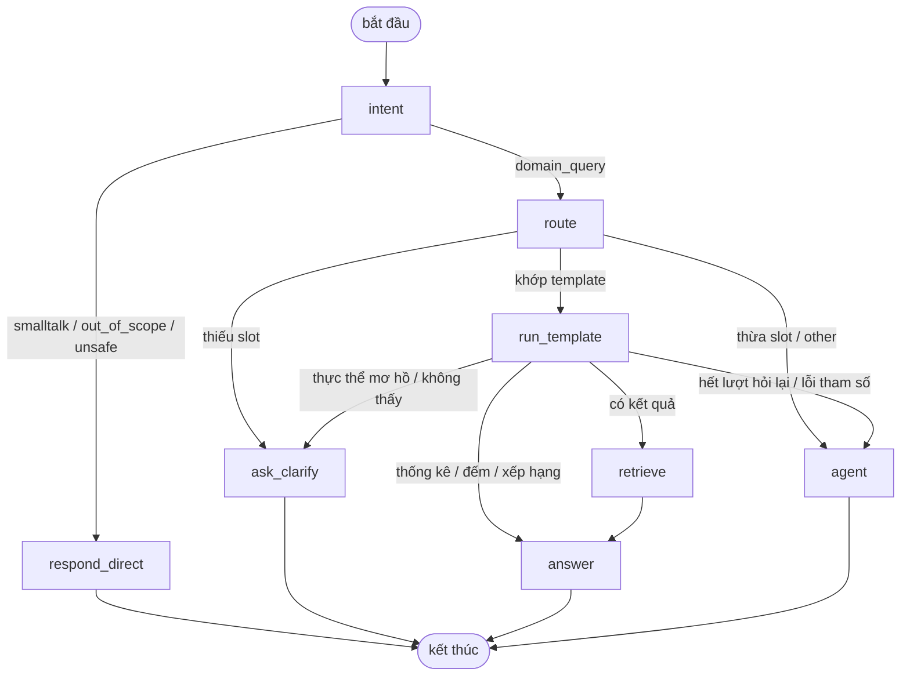

# legal_knowledge_graph

Đồ thị tri thức văn bản pháp quy trong Neo4j, xây bằng cách gán tay
(JSON → graph) thay vì trích xuất tự động. Bù lại điểm yếu recall của
pipeline regex/NLP ở `src/vanban/kg/` cho nhóm quan hệ hiệu lực
(`REPLACES`, `AMENDS`, `REPEALS`).

Package độc lập trong `src/`, ngang hàng `src/vanban/`: không import code
của `src/vanban/`, dùng Neo4j instance riêng. Hạ tầng (`.env`,
`requirements.txt`, `docker-compose.yml`, `run.py`) dùng chung với gốc
repo, biến môi trường tách riêng bằng tiền tố `LKG_`.

Trên nền graph có một chatbot tra cứu xây bằng LangChain + LangGraph
(`core/chat/`), phục vụ qua API FastAPI (`core/api/`) và giao diện chat
React (`frontend/`).

## Cấu trúc

```
src/legal_knowledge_graph/
├── schema/document.schema.json     JSON Schema cho file gán tay
├── reference/                      topics / target_groups / organizations / aliases seed
├── samples/                        17 văn bản mẫu, dùng cho regression test
├── core/
│   ├── config.py                     Cấu hình, đọc .env gốc repo
│   ├── observability.py              Log JSON có cấu trúc + LangSmith tracing
│   ├── normalize.py                  Chuẩn hoá số hiệu, slug, ngày; nhận diện số hiệu trong câu (dùng chung)
│   ├── reference.py                  Đọc danh mục seed trong reference/ (dùng chung)
│   ├── db.py                         Kết nối Neo4j (driver dùng chung, session CLI), chạy Cypher có timeout, ghi theo lô
│   ├── ingest/                       JSON → Neo4j: validate, collision_check, graph_model,
│   │                                   graph_loader, build (`build`), build_pipeline (`all`)
│   ├── graph_query/                  Truy vấn đồ thị, không phụ thuộc chatbot:
│   │   ├── templates/                  kho 68 template Cypher (6 nhóm, mức 1–5)
│   │   ├── schema.py                   mô tả schema graph
│   │   ├── cypher_guard.py             kiểm duyệt Cypher do LLM viết
│   │   ├── entity_resolver.py          tên thô → khoá trong graph (+ entity_aliases.py)
│   │   ├── graph_context.py            Cypher GraphRAG: Điều hạt giống, mở rộng theo quan hệ
│   │   └── article_embeddings.py       backfill embedding (`lkg embed-articles`)
│   ├── llm/gemini_key_pool.py        Bể key Gemini xoay vòng (chatbot + embedding)
│   ├── chat/                         Chatbot LangGraph (mục "Chatbot"), kèm bộ câu hỏi gold chat_eval.py (`lkg chat-eval`)
│   └── api/                          FastAPI cho chat UI
├── frontend/                       Chat UI (React + Vite)
├── docs/                           GUIDELINE, GRAPHREPORT, STRUCTUREDFORM, EXAMPLE, TEMPLATES (sinh tự động)
├── tests/                          Kiểm thử pytest (offline; phần live tự bỏ qua nếu Neo4j tắt)
└── run.py                          Điểm vào CLI, gọi qua `python run.py lkg <lệnh>`
```

Bộ đo Cypher (regression trên `samples/`, hiệu năng, 20 kịch bản có P/R/F1)
không thuộc module này mà nằm ở `src/cypher_benchmark/`, chạy bằng
`python run.py bench --source samples|benchmark|scenarios`. Hai bên chỉ dùng
chung Neo4j (biến `LKG_NEO4J_*`), không import mã của nhau.

## Cài đặt

```powershell
pip install -r requirements.txt
docker compose up -d
Copy-Item .env.example .env
```

Neo4j riêng cho module này: Browser `http://localhost:7475`, Bolt
`bolt://localhost:7688`, user/pass `neo4j`/`lkg12345678` — khác cổng với
instance chính (`7474`/`7687`) của pipeline tự động.

Docker Desktop phải đang chạy; container `neo4j-pbl6-lkg` tự khởi động cùng
Docker. Lệnh `docker compose up -d neo4j-lkg` có thể báo "Conflict" về tên
container do container hiện có được tạo dưới một tên compose project khác;
lỗi này vô hại vì container đã chạy. Không xoá container này (chứa volume dữ
liệu).

| Biến | Mặc định | Dùng cho |
|---|---|---|
| `LKG_NEO4J_URI` / `_USER` / `_PASSWORD` / `_DATABASE` | xem trên | Kết nối Neo4j |
| `LKG_LLM_PROVIDER` | `gemini` | Nhà cung cấp LLM: `gemini` hoặc `openai_compatible` (mục "Đổi LLM và embedding") |
| `LKG_LLM_MODEL` | `gemini-3.6-flash` | Model của chatbot (`LKG_GEMINI_MODEL` là tên cũ, vẫn được đọc) |
| `LKG_LLM_BASE_URL` / `LKG_LLM_API_KEY` | (rỗng) | Địa chỉ và key server, chỉ cho `openai_compatible` |
| `LKG_LLM_STRUCTURED_METHOD` | `json_schema` | Cách ép output có cấu trúc với `openai_compatible`: `json_schema`, `function_calling`, `json_mode` |
| `LKG_LLM_FALLBACK_MODEL` | (rỗng = tắt) | Model Gemini dự phòng khi model chính báo 503 quá tải (mục "Bể key Gemini") |
| `LKG_LLM_TIMEOUT_SECONDS` | `30` | Trần cho một request LLM |
| `LKG_TURN_DEADLINE_SECONDS` | `60` | Trần thời gian cho cả một lượt hỏi; `0` = không giới hạn |
| `LKG_GEMINI_API_KEY_<n>` | (rỗng) | Bể key Gemini — gộp chung với `GEMINI_API_KEY_*`/`GEMMA_API_KEY_*` (`config.gemini_keys()`) |
| `LKG_EMBED_PROVIDER` / `LKG_EMBED_MODEL` / `LKG_EMBED_DIMENSIONS` | `gemini` / `gemini-embedding-001` / `768` | Embedding cho GraphRAG, chọn độc lập với LLM |
| `LKG_NLQ_ROW_CAP` | `200` | Số dòng tối đa mỗi truy vấn Cypher |
| `LKG_NLQ_QUERY_TIMEOUT_SECONDS` | `10` | Timeout Cypher phía server |
| `LKG_NLQ_MAX_CLARIFY_ROUNDS` | `2` | Số lượt hỏi lại tối đa trước khi chuyển agent |
| `LKG_CORS_ORIGINS` | `http://localhost:5173,http://127.0.0.1:5173` | Origin được gọi chat API; thêm domain giao diện khi deploy |
| `LKG_CHAT_HISTORY_WINDOW` | `6` | Số tin nhắn gần nhất dùng để hiểu câu hỏi nối tiếp |
| `LKG_AGENT_MAX_STEPS` | `4` | Số vòng LLM tối đa của agent |
| `LKG_ANSWER_MAX_ROWS` | `30` | Số dòng kết quả đưa vào prompt trả lời |
| `LKG_RETRIEVAL_ENABLED` | `true` | Bật GraphRAG (bước `retrieve` và tool `search_articles`) |
| `LKG_LOG_LEVEL` | `INFO` | Mức log; `DEBUG` ghi thêm Cypher, params, dòng mẫu, traceback |
| `LKG_SESSION_LOG` / `LKG_SESSION_LOG_DIR` | `true` / `logs/sessions` | Log theo phiên hội thoại (mục "Quan sát và debug") |
| `LANGSMITH_TRACING` | `false` | Bật/tắt LangSmith tracing (`true` để bật) |
| `LANGSMITH_API_KEY` / `LANGSMITH_PROJECT` | (rỗng) / `pbl6-legal-chatbot` | Khoá và project LangSmith, chỉ dùng khi `LANGSMITH_TRACING=true` |

Phiên bản thư viện chatbot được ghim chính xác trong `requirements.txt`
(`langchain-core 1.6.5`, `langgraph 1.2.12`, `langgraph-checkpoint 4.2.0`,
`langchain-google-genai 4.4.0`, `langsmith 0.14.1`, `langchain-openai 1.6.6`,
`openai 3.19.2`), đã kiểm tương thích với `google-genai 2.24`, `pydantic 2.13`,
`fastapi 0.141`, `neo4j 6.3` (`pip check` sạch).

## Quy trình dữ liệu

```
data/clean/text_final/*.txt (OCR, thuộc src/vanban/)
        ↓  gán tay theo schema/document.schema.json
data/clean/json/<version>/*.json
        ↓  validate → build
Neo4j
```

Một file JSON = một văn bản. Chi tiết field: `schema/document.schema.json`,
bản diễn giải: `docs/STRUCTUREDFORM.md`. Field không chắc thì để `null`/`[]` kèm
lý do trong `note`, không đoán. Văn bản đích của trích dẫn chưa có JSON riêng
thì hệ thống tự tạo `Document` stub.

## CLI

```powershell
python run.py lkg validate [--dir DIR]
python run.py lkg check-collisions [--dir DIR]
python run.py lkg build [--dir DIR] [--wipe]
python run.py lkg all [--dir DIR] [--no-wipe]
python run.py lkg ask "<câu hỏi>" [--verbose]
python run.py lkg ask --template TPL_XXX --param k=v
python run.py lkg chat [--verbose]
python run.py lkg templates [--stdout]
python run.py lkg chat-eval [--verbose] [--with-retrieval]
python run.py lkg embed-articles [--batch-size N] [--read-batch-size N] [--dry-run] [--verbose]
python run.py lkg serve-api [--host HOST] [--port PORT] [--reload]
```

| Lệnh | Việc làm |
|---|---|
| `validate` | JSON Schema + kiểm tra chéo, đệ quy, bỏ qua thư mục `_...` |
| `check-collisions` | Báo cáo `normalizedNumber` bị ≥2 file trùng |
| `build` | Validate rồi nạp vào Neo4j (`--wipe` để nạp lại từ đầu) |
| `all` | check-collisions → validate → build → sanity. Mặc định đọc `samples/`; dữ liệu thật: `--dir data/clean/json/v2` |
| `ask` | Hỏi chatbot một câu; `--template` chạy thủ công một template, không qua LLM |
| `chat` | Hội thoại nhiều lượt trong terminal (`/new` mở hội thoại mới, `/exit` thoát) |
| `templates` | Sinh lại `docs/TEMPLATES.md` — danh mục 68 template từ `core/graph_query/templates/` |
| `chat-eval` | Bộ câu hỏi gold cho chatbot, chạy thật qua Gemini + Neo4j |
| `embed-articles` | Backfill embedding cho Article — chạy tay, tốn quota Gemini |
| `serve-api` | Chạy FastAPI cho chat UI |

## Đồ thị

7 loại node (`Document`, `Organization`, `Person`, `Topic`, `TargetGroup`,
`NormativeContent`, `Article`), quan hệ chính: `ISSUED_BY`, `SIGNED_BY`,
`HAS_TOPIC`, `APPLIES_TO`, `MENTIONS`, `PROMULGATES`, `HAS_ARTICLE`, và
nhóm hiệu lực/trích dẫn `BASED_ON`/`REFERENCES`/`REPLACES`/`AMENDS`/
`REPEALS`. 3 full-text index (`doc_text`, `article_text`, `content_text`) và
1 vector index (`article_embedding`). Nạp bằng `MERGE` nên `build` chạy lại
nhiều lần không nhân đôi dữ liệu.

Số liệu graph, vấn đề dữ liệu đã biết, benchmark hiệu năng: `docs/GRAPHREPORT.md`.

## Chatbot

### Luồng xử lý



| Node | Lượt gọi LLM | Việc |
|---|---|---|
| `intent` | 1 | Phân loại `domain_query` / `smalltalk` / `out_of_scope` / `unsafe` (ghi/xoá dữ liệu, prompt injection); viết lại câu hỏi nối tiếp thành câu độc lập từ lịch sử hội thoại; với câu ngoài domain trả luôn câu đáp |
| `respond_direct` | 0 | Trả câu đáp ngắn kèm gợi ý loại câu hỏi bot làm được |
| `route` | 1 | LLM trích **khung câu hỏi**: `action` (56 loại) + 14 slot (org, topic, target_group, doc_number, person, position, status, doc_type, content_type, year, since_year, article_number, phrase, limit) ở cùng một cấp. `TemplateSelector` chọn 1 trong 68 template |
| `run_template` | 0 | Resolve slot thành khoá thật (alias + so khớp mờ, không LLM), chạy Cypher đã kiểm duyệt |
| `ask_clarify` | 0 | Hỏi lại khi thiếu slot hoặc thực thể mơ hồ / không tồn tại, kèm ứng viên |
| `retrieve` | embed | GraphRAG theo mức của action: Điều liên quan + hiệu lực thực tế + quan hệ (mục bên dưới); lỗi không chặn luồng |
| `answer` | 1 | Viết câu trả lời chỉ từ bằng chứng, dẫn số hiệu, nêu hiệu lực. Không có bằng chứng thì dùng câu cố định, không gọi LLM |
| `agent` | 2–4 | Subgraph ReAct (`llm` ⇄ `ToolNode`) với 3 tool: `run_template`, `run_cypher` (qua guard), `search_articles`. Nhận câu đã viết lại cùng lịch sử hội thoại, tin nhắn gốc và khung router (action + slot); danh mục template trong prompt thu hẹp theo action (~8.000 thay vì ~15.000 ký tự), action `other` giữ danh mục đủ |

Câu hỏi phổ biến tốn 3 lượt gọi LLM; câu ngoài domain 1 lượt; câu qua agent
4–6 lượt.

### GraphRAG (bước `retrieve`)

Kết quả template phần lớn là metadata (số hiệu, tiêu đề, hiệu lực), không có
nội dung quy định. Bước `retrieve` bổ sung toàn văn các Điều liên quan và
ngữ cảnh quan hệ quanh văn bản chứa chúng, theo kiểu *local search*. Bước
này không gọi thêm LLM: mỗi câu hỏi chỉ tốn 1 lượt embed và 5 câu Cypher,
đo trên graph thật dưới 0,5 giây.

**Mức truy xuất theo action** (`core/graph_query/templates/actions.py`):

| Mức | Action | Làm gì |
|---|---|---|
| `full` | hỏi nội dung quy định (`search_articles`, `article_text`, `document_contents`, `latest_document_about`...) | đủ 4 bước bên dưới |
| `scope` | mặc định: liệt kê văn bản, quan hệ thay thế / sửa đổi, metadata một văn bản | bỏ hạt giống toàn kho, chỉ lấy Điều trong các văn bản câu hỏi nêu tên / template trả về; vẫn hiệu chỉnh hiệu lực |
| `none` | thống kê, đếm, xếp hạng, hồ sơ người / cơ quan | bỏ hẳn bước `retrieve` |

| Bước | Cách làm |
|---|---|
| 1. Hạt giống | 8 Điều từ vector index `article_embedding` và 8 Điều từ fulltext BM25 `article_text`, gộp bằng Reciprocal Rank Fusion, giữ 5. Truy vấn BM25 dùng slot `phrase` của router nếu có; không thì `entity_resolver.keyword_query()` rút từ câu hỏi: bỏ số hiệu và từ để hỏi / từ chung ("văn bản", "quy định", "nào", "gì"...), phát cặp hai âm tiết `"a b"^2` cùng âm tiết đơn. Trên 12 câu hỏi nội dung, số Điều trùng giữa fulltext và vector top-8 tăng từ 47/96 lên 51/96. Bỏ các Điều "hiệu lực thi hành / trách nhiệm thi hành" (1.000/8.814 Điều): chúng gần nghĩa với hầu hết câu hỏi nhưng không mang nội dung quy định |
| 2. Phạm vi | Văn bản trong phạm vi gồm văn bản được câu hỏi nêu tên (tham số `normalizedNumber` đã resolve) và văn bản trong các dòng kết quả template. Lấy thêm 2 Điều gần nghĩa nhất trong mỗi văn bản (tối đa 5 văn bản), chấm cosine trực tiếp; các văn bản này đứng đầu ngữ cảnh. So khớp phạm vi theo khoá chuẩn hoá `Document.normalizedNumber` |
| 3. Mở rộng | Với mỗi văn bản chứa Điều: cơ quan ban hành, văn bản thay thế / bãi bỏ / sửa đổi nó (kèm Điều bị sửa nếu có), 3 căn cứ chính. Điều quá ngắn được kèm Điều liền trước và liền sau trong cùng văn bản |
| 4. Đóng gói | Gom theo văn bản, cắt mỗi Điều 1.500 ký tự, tổng không vượt 12.000 ký tự (Điều cuối được cắt cho vừa nếu còn ≥ 300 ký tự) |

**Hiệu lực thực tế.** Quan hệ được ưu tiên hơn thuộc tính: văn bản đã có
văn bản khác `REPLACES`/`REPEALS` được coi là hết hiệu lực, và ngữ cảnh
nêu rõ văn bản thay thế. Trong kho có 44 văn bản rơi vào trường hợp này mà
thuộc tính `status` vẫn ghi `CON_HIEU_LUC`. Cạnh mà văn bản "thay thế" được
ban hành *trước* văn bản bị thay thế được coi là lỗi trích xuất và bị bỏ qua
(1 trường hợp). Dữ liệu trong Neo4j không bị sửa; phần hiệu chỉnh chỉ áp
dụng cho câu trả lời, nguồn trích dẫn và trường `retrieval` của API
(`effectiveStatus`, `supersededBy`).

Agent dùng cùng cơ chế này qua tool `search_articles`.

### Kho template

68 template Cypher đã kiểm duyệt trong `core/graph_query/templates/`, chia 6 nhóm nghiệp
vụ: tra cứu danh sách văn bản, hỏi về một văn bản, quan hệ giữa văn bản, tìm
theo nội dung, người ký và cơ quan, thống kê. Mỗi nhóm sắp từ đơn giản (mức 1)
tới phức tạp (mức 5), từ câu sinh viên / phụ huynh / giảng viên hay hỏi tới câu
phục vụ quản lý và quản trị dữ liệu. Danh mục đầy đủ: [TEMPLATES.md](docs/TEMPLATES.md)
(sinh bằng `python run.py lkg templates`).

| Mức | Ý nghĩa | Số template |
|---|---|---|
| 1 | tra cứu 1 bước | 17 |
| 2 | nhiều quan hệ / nhiều điều kiện | 30 |
| 3 | nhiều bước, full-text có lọc | 14 |
| 4 | chuỗi nhiều tầng, kết hợp | 5 |
| 5 | tổng hợp toàn graph | 2 |

Mỗi template tự khai `action`, mức, nhóm người hay hỏi và tham số ví dụ lấy từ
dữ liệu thật; `tests/test_templates_live.py` chạy cả 68 template trên Neo4j và
yêu cầu mỗi template trả về dữ liệu. ĐHBK đang bị tách thành hai node cơ quan
khi gán tay, nên điều kiện theo cơ quan khớp cả các orgId cùng tiền tố.

### Chọn template: khung action + slot

LLM chỉ làm phần hiểu ngôn ngữ; `core/chat/understanding/template_selector.py` dựng
luật chọn **tự động từ kho template** (action của template, slot bắt buộc / nhận
được suy từ tham số), không có bảng ánh xạ riêng:

| Kết quả so khớp | Hành động |
|---|---|
| Mọi slot đã điền đều được template nhận, đủ slot bắt buộc; nhiều template khớp thì chọn template cụ thể nhất | chạy template |
| Không thừa slot nhưng thiếu slot bắt buộc | hỏi lại (tối đa 3 phương án) |
| Có slot không template nào của action nhận | chuyển agent — không âm thầm bỏ bộ lọc |
| `action = other` | chuyển agent |

Câu nhiều điều kiện lọc (cơ quan + lĩnh vực + đối tượng + loại + năm + hiệu lực)
đi qua template lọc kết hợp `TPL_DOCS_FILTERED` thay vì agent. Thêm template mới
chỉ cần khai trong nhóm tương ứng; kiểm tra lúc import bảo đảm tên tham số có
slot, có tham số ví dụ và được dùng trong Cypher.

**Schema đầu ra phẳng.** Structured output của router đặt `action` và 14
trường slot ở cùng một cấp thay vì lồng trong một object `slots`. Đo trên 20
câu hỏi định tuyến (15 câu gold một lượt + 5 câu bổ sung), sau bước bù số
hiệu: schema lồng chọn đúng template 11/20, schema phẳng 16/20.

**Mọi key slot là bắt buộc (giá trị vẫn được `null`).** 4 câu còn sai với
schema phẳng có cùng một nguyên nhân, thấy rõ trong output thô của Gemini:
slot là key tuỳ chọn nên model bỏ hẳn key, nhảy từ `action` sang vài key cuối
(ví dụ `{"action": "list_documents", "article_number": null, "phrase": null,
"limit": null}` — không có key `topic`). Khi bắt buộc đủ 15 key, trên 8 câu
thử (4 câu từng sai, 4 câu kiểm hồi quy, 2–3 lượt mỗi câu) mọi output đều đủ
key và slot đúng; `tests/test_template_selector.py` giữ ràng buộc này.

**Bù `doc_number` bằng regex.** Gemini đôi khi để trống `doc_number` khi số
hiệu là chủ ngữ ("Văn bản 2673/QĐ-ĐHBK quy định gì về …"; tái hiện 2 lần).
`RouterService` bù slot này bằng `normalize.find_document_numbers()` khi LLM để
trống **và** câu hỏi chứa đúng một số hiệu; câu có nhiều số hiệu (ví dụ câu so
sánh) không bị đoán. `ROUTER_SYSTEM` cũng có thêm quy tắc luôn điền
`doc_number` khi câu hỏi có số hiệu.

`find_document_numbers()` nhận các dạng `2673/QĐ-ĐHBK`, `08/2021/TT-BGDĐT`,
`30a/2008/NQ-CP`, `57-NQ/TW` và loại ngày, phân số, mã (`12/3/2024`,
`2024/2025`, `3/4`, `COVID-19/SARS`). Kiểm trên toàn bộ 1.399 số hiệu trong
graph: nhận đúng 1.394; 5 trường hợp trượt là lỗi dữ liệu hoặc dạng hiếm (2 số
hiệu thiếu phần số, 1 stub thực chất là ngày, `426-TTg` không có dấu `/`, 1 ký
hiệu chứa dấu phẩy).

### Tìm theo cụm từ (full-text)

`entity_resolver.resolve_fulltext_phrase()` dựng truy vấn Lucene theo độ dài
cụm:

| Cụm | Truy vấn | Lý do |
|---|---|---|
| ≥ 3 âm tiết | `"cụm"^2 OR (âm_tiết_1 AND âm_tiết_2 ...)` | Khớp nguyên cụm xếp đầu, nhưng Điều chứa đủ các âm tiết theo thứ tự khác vẫn được trả về |
| 1–2 âm tiết | `"cụm"` (khớp nguyên cụm) | Từ ghép 2 âm tiết tách ra khớp quá rộng: "học vụ" khớp 1.537 Điều thay vì 11 |

Đo trên 12 cụm: "nguyên tắc quản lý tài sản công" tăng từ 0 lên 57 kết quả,
Điều đúng đứng đầu; 11 cụm còn lại giữ nguyên kết quả top-1.

### Hội thoại nhiều lượt

Lịch sử lưu bằng LangGraph checkpointer `MemorySaver` theo `thread_id` (trong
RAM, mất khi khởi động lại server). Câu nối tiếp ("nó thay thế văn bản nào?")
và câu trả lời cho lượt hỏi lại được node `intent` ghép thành câu hỏi đầy đủ,
nên không cần cơ chế resume riêng. Tối đa 2 lượt hỏi lại, sau đó chuyển agent.

### Kiến trúc mã

Thư mục con xếp theo đúng thứ tự một lượt hỏi đi qua graph; mỗi file một
trách nhiệm.

```
core/chat/
├── chat_service.py     ChatService — facade duy nhất cho API, CLI, eval
├── container.py        Composition root: ráp bản cài cụ thể; kiểm thử tiêm bản giả
├── cli.py              Lệnh ask / chat
├── ports.py            Interface: LLMProvider, QueryExecutor, EntityResolver, ContextRetriever
├── prompts.py          Prompt và câu trả lời cố định; ANSWER_RULES dùng chung answer + agent
├── agent.py            Agent ReAct (subgraph llm ⇄ tools) với 3 tool
├── models/             frames (output LLM, quyết định chọn template) · results · graph_context
│                       · state (state LangGraph) · response (ChatResponse)
├── workflow/           nodes (mỗi method một node, @safe_node bắt lỗi) · builder
├── understanding/      Bước 1, node intent/route: intent · history · router · template_selector
├── retrieval/          Bước 2, node run_template/retrieve: template_query · graph_rag
├── answering/          Bước 3, node answer/ask_clarify: answer · evidence · clarification
└── adapters/           Cài đặt các port: gemini_llm · neo4j_adapters · graph_retriever
```

Các bước phụ thuộc vào `ports`, không vào Gemini hay Neo4j cụ thể; phụ thuộc
chỉ được ráp ở `container.py`. Các khối trong `core/graph_query/` (templates,
entity_resolver, cypher_guard, graph_context, schema) được dùng lại qua
`adapters/`; mọi kết nối Neo4j đi qua `core/db.py`. Phụ thuộc chỉ đi một chiều
`chat → graph_query → db`.

### Đổi LLM và embedding

LLM và embedding chọn bằng biến môi trường, không sửa code. Hai nhà cung cấp:

| `LKG_LLM_PROVIDER` | Dùng cho | Adapter |
|---|---|---|
| `gemini` (mặc định) | Gemini Developer API, bể nhiều key xoay vòng | `chat/adapters/gemini_llm.py` |
| `openai_compatible` | Mọi server chuẩn OpenAI API: tự host trên cloud (vLLM, Ollama, TGI, LM Studio) hoặc dịch vụ (OpenAI, OpenRouter, Together, Groq, DeepSeek) | `chat/adapters/openai_compatible_llm.py` |

Ví dụ chuyển sang một model tự host bằng vLLM:

```
LKG_LLM_PROVIDER=openai_compatible
LKG_LLM_BASE_URL=http://<host>:8000/v1
LKG_LLM_MODEL=Qwen/Qwen2.5-14B-Instruct
LKG_LLM_API_KEY=            # để trống nếu server không kiểm key
```

Server phải hỗ trợ hai khả năng chatbot dùng: output có cấu trúc cho node
`intent`, `route` (JSON Schema qua `response_format`; server chưa hỗ trợ thì
đặt `LKG_LLM_STRUCTURED_METHOD=function_calling`) và tool calling cho agent
(với vLLM: `--enable-auto-tool-choice --tool-call-parser <parser của model>`).
Cấu hình sai (provider lạ, thiếu model, method lạ) báo lỗi ngay khi khởi động.

Hai adapter dùng chung lớp nền `chat/adapters/langchain_llm.py` (structured
output, tool calling, log, đếm lượt gọi); chỉ khác cách gọi model. Lớp nào
được dùng do `container.py::build_llm()` quyết định — chỗ duy nhất biết đang
dùng nhà cung cấp nào. Thêm một nhà cung cấp khác: viết một lớp con của
`LangChainLLM` và thêm một nhánh trong `build_llm()`.

**Embedding** chọn riêng bằng `LKG_EMBED_PROVIDER` (cùng hai giá trị,
`core/llm/embeddings.py`), nên có thể đổi LLM mà vẫn giữ embedding Gemini.
Đổi model hoặc số chiều embedding thì vector cũ không còn dùng được:

```
LKG_EMBED_PROVIDER=openai_compatible
LKG_EMBED_MODEL=BAAI/bge-m3
LKG_EMBED_DIMENSIONS=1024
python run.py lkg embed-articles --reset    # xoá embedding cũ, dựng lại index 1024 chiều, embed lại
```

Mọi vector được kiểm số chiều so với `LKG_EMBED_DIMENSIONS`; `embed-articles`
dừng nếu vector index trong Neo4j có số chiều khác cấu hình và hướng dẫn chạy
`--reset`. Test `tests/test_llm_providers.py` chạy provider `openai_compatible`
qua một server giả chuẩn OpenAI cục bộ (structured output, tool calling,
embedding, kiểm số chiều).

### Bể key Gemini

`core/llm/gemini_key_pool.py::call_with_pool()` là vòng xoay key duy nhất, dùng
chung cho LLM của chatbot và embedding: key dính 429/503 nghỉ theo
`retryDelay` rồi thử ngay key khác, key 401/403 bị loại. Mỗi key có một
`ChatGoogleGenerativeAI` riêng với `max_retries=1` (không tự retry) để bể tự
xoay. Bể tách theo model (`generate:<model>`, `embed`) vì quota tính theo model.

**Trần thời gian.** Mỗi lời gọi qua bể dừng ở mốc sớm hơn giữa 90 giây và hạn
chót của lượt hỏi (`LKG_TURN_DEADLINE_SECONDS`, mặc định 60). Trước đây trần chỉ
áp cho từng lời gọi, nên một lượt agent 6 lời gọi gặp 503/504 liên tục từng
kéo tới 202 giây (`intent` 5 lần thử, `route` 10 lần). Quá hạn thì lượt kết
thúc với câu báo lỗi thân thiện.

**Model dự phòng.** 503 "high demand" là quá tải của model, đổi key không
giúp được. Khi đặt `LKG_LLM_FALLBACK_MODEL`, 503 ở model chính được gọi lại
ngay bằng model dự phòng (không cho key nghỉ 45 giây), và model chính bị bỏ qua
trong 60 giây sau đó. Log `llm` ghi model thực dùng; mỗi lần chuyển có một dòng
`llm.fallback`.

### API và giao diện

`POST /api/chat` nhận `{question, thread_id?}` (câu hỏi tối đa 1.000 ký tự),
trả:

```
{thread_id, turn_id, trace_id, kind, intent, answer, clarification{question, candidates},
 action, template, cypher, params, rows, retrieval, retrieval_reason, sources, elapsed_ms, llm_calls}
```

`kind`: `answer`, `agent_answer`, `no_data`, `clarification`, `direct`, `error`.

Giao diện chỉ hiển thị câu trả lời và nút ứng viên khi bot hỏi lại; chi tiết
từng bước nằm ở log phiên (mục "Quan sát và debug"). API vẫn trả đủ các trường
trên cho CLI `--verbose` và `chat-eval`. Nút "Cuộc hội thoại mới" bỏ
`thread_id`, nên lượt kế tiếp mở một phiên (và một file log phiên) mới.

```powershell
python run.py lkg serve-api          # http://localhost:8000

cd src/legal_knowledge_graph/frontend
npm install && npm run dev            # http://localhost:5173
```

### Vấn đề đang mở

- Router: lỗi slot rỗng (4/20 câu) đã tìm ra nguyên nhân và đã sửa (bắt buộc
  mọi key slot); chưa đo lại trọn bộ 20 câu vì quota Gemini trong ngày đã hết.
- Văn bản `2673/QĐ-ĐHBK` đã bị `1092/QĐ-ĐHBK` thay thế nhưng thuộc tính
  `status` trong graph vẫn ghi `CON_HIEU_LUC`; chatbot cảnh báo theo quan hệ
  (mục GraphRAG), dữ liệu chưa sửa.

## Quan sát và debug

**Log cục bộ** — `logs/chat.log` (JSON mỗi dòng, xoay vòng 5 MB × 3) và
console. Mọi dòng mang `thread_id` + `turn_id`; lọc theo `turn_id` để xem
trọn một lượt:

| stage | Nội dung |
|---|---|
| `turn.start` / `turn.end` | câu hỏi, kind, tổng ms, số lượt LLM, trace_id |
| `intent` | intent, câu hỏi đã viết lại |
| `route` | action, slots, quyết định (template / thiếu / thừa) |
| `resolve` | giá trị thô → khoá, hoặc ứng viên khi mơ hồ |
| `cypher` | template hoặc `freeform`, số dòng, ms (DEBUG: Cypher, params, 5 dòng đầu) |
| `guard` | Cypher bị chặn và lý do |
| `agent.tool` / `agent` | tool đã gọi, số dòng/Điều trả về, số bước |
| `graph_rag.seed` / `graph_rag` | số Điều từ vector / fulltext / phạm vi, số trùng; số văn bản, số Điều, văn bản bị hiệu chỉnh hiệu lực, số ký tự (DEBUG: từng Điều, điểm RRF, nguồn) |
| `llm` | node, model, key (dạng `#2`), số lần thử, ms |
| `keypool` | key bị cho nghỉ / bị loại, lý do |
| `error` | node, loại lỗi (DEBUG: traceback) |

**Log theo phiên** — `logs/sessions/<YYYY-MM-DD>/<HHMMSS>_<thread_id>.log`,
một file văn bản cho mỗi cuộc hội thoại (`thread_id`), viết để đọc khi debug
(`core/chat/session_log.py`). Mỗi lượt người dùng nhắn là một khối `LƯỢT n`,
bên trong theo đúng thứ tự chạy:

| Khối | Nội dung |
|---|---|
| `[<node>] LLM <model>` | ms, số lần thử, key; **đầu vào** đầy đủ (system prompt, lịch sử, câu hỏi, bằng chứng) và **đầu ra** (JSON structured / văn bản / tool call) |
| `[<node>] đầu ra node` | state node vừa ghi: intent + câu viết lại, action + slot + template + tham số thô, Cypher + tham số đã resolve + dòng kết quả, hỏi lại + ứng viên... |
| `[retrieve] GraphRAG — hạt giống` | mức truy xuất, văn bản phạm vi, truy vấn Lucene, xếp hạng từ vector / fulltext / phạm vi, hạt giống sau RRF |
| `[agent.tool] <tool>` | Cypher (nếu có) và đúng nội dung kết quả agent đọc ở bước sau |
| `[<node>] LỖI` | lỗi kèm traceback |
| `KẾT QUẢ LƯỢT` | kind, số lượt LLM, tổng ms, câu trả lời gửi người dùng, ứng viên, nguồn, `trace_id` |

System prompt chỉ in đầy đủ ở lần đầu trong file (các lần sau ghi `giống prompt
#n`); tin nhắn agent gửi lại ở mỗi bước chỉ in một lần mỗi lượt. Một phiên
2 lượt có GraphRAG khoảng 80 KB. Ghi file lỗi không làm hỏng lượt hỏi; pytest
tắt log phiên (`tests/conftest.py`).

**LangSmith** — mặc định tắt (`LANGSMITH_TRACING=false` trong `.env`). Để bật,
đặt `LANGSMITH_TRACING=true` và điền `LANGSMITH_API_KEY`. Bộ kiểm thử luôn tắt
tracing (`tests/conftest.py` ép `LANGSMITH_TRACING=false` trước khi import
`core`), vì trước đây mỗi lần chạy pytest tạo khoảng 60 trace và làm cạn quota
trace hằng tháng ("Monthly unique traces usage limit exceeded"). Mỗi lượt hỏi là một
trace `legal_chat` (metadata `thread_id`, `turn_id`, `model`; tag intent,
action, template). Node, lời gọi LLM, tool hiện tự động; Cypher, resolve,
chọn template và GraphRAG (`graph_rag` với hai run con `seed`, `expand`) được
bọc `traceable` nên cũng hiện thành run con.
`trace_id` trả về trong response để tra đúng trace. Khi bật, câu hỏi, Cypher
và dòng kết quả được gửi lên LangSmith; API key không bao giờ được log.

## Kiểm thử

```powershell
python -m pytest src/legal_knowledge_graph/tests -q     # offline, ~2 giây
python run.py lkg chat-eval                               # thật, tốn quota Gemini
```

Bộ offline dùng bản giả của các port (`tests/fakes.py`) để chạy mọi nhánh
của graph: smalltalk, template, không có dữ liệu, hỏi lại rồi hoàn tất cùng
`thread_id`, thực thể không tồn tại, nhiều điều kiện sang agent, agent dừng
đúng số bước, lỗi Neo4j, lỗi retrieval; cùng bảng ánh xạ của `TemplateSelector`
và bước bù `doc_number` của router (`tests/test_chat_graph.py`).
`tests/test_text_matching.py` kiểm regex nhận diện số hiệu và truy vấn Lucene
theo cụm từ. Toàn bộ 186 kiểm thử đạt (offline + Neo4j thật), gồm `tests/test_llm_providers.py` chạy provider `openai_compatible` qua server giả chuẩn OpenAI, và `tests/test_api.py` kiểm API dựng chatbot lúc khởi động và CORS.

Kiểm chứng đầu-cuối với Gemini + Neo4j thật (11/10/2026):

| Câu hỏi | Template | Kết quả | LLM / thời gian |
|---|---|---|---|
| "Văn bản 2673/QĐ-ĐHBK quy định gì về nguyên tắc quản lý tài sản công?" | `TPL_DOC_ARTICLE_SEARCH` | GraphRAG trả Điều 3 của 2673/QĐ-ĐHBK; câu trả lời cảnh báo văn bản đã bị 1092/QĐ-ĐHBK thay thế và dẫn thêm Điều 3 của 1092 | 3 lượt, ~20 s |
| "Văn bản nào đã thay thế 2673/QĐ-ĐHBK?" | `TPL_REPLACED_BY` | 1092/QĐ-ĐHBK, kèm cảnh báo hiệu lực | 3 lượt, ~15 s |

`chat-eval` báo riêng độ chính xác từng tầng: intent, action, template,
entity-linking, kind cuối, và các hội thoại nhiều lượt.

## Tài liệu liên quan

- `docs/GRAPHREPORT.md` — schema, số liệu graph, benchmark, vấn đề dữ liệu đã biết.
- `docs/STRUCTUREDFORM.md` — diễn giải đầy đủ `document.schema.json`.
- `docs/EXAMPLE.md` — 20 câu hỏi mẫu kèm Cypher.
